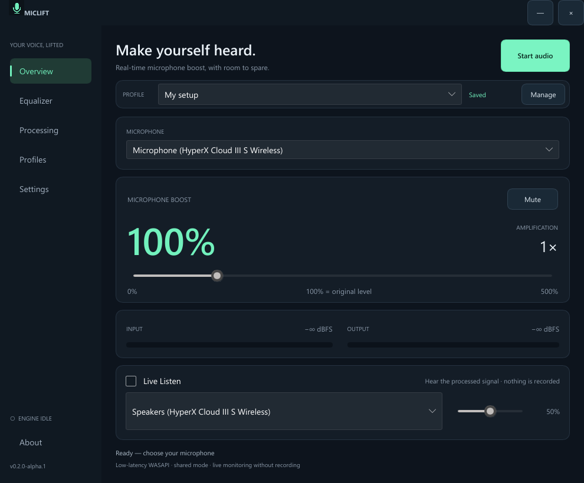

# MicLift

A lightweight, open-source Windows microphone booster with a native studio-style UI.

[](https://github.com/Malasuerte94/miclift/actions/workflows/ci.yml)



**0–500% microphone boost · five-band parametric EQ · saved profiles · live listening · system tray**

MicLift is a new application written in Rust, using WASAPI directly for shared-mode audio and Slint for its native UI. It does not use a browser runtime, record your microphone to files, send audio over the network, or require an account. Application code is MIT licensed. Slint and other dependencies have their own licenses; see [THIRD_PARTY_NOTICES.md](THIRD_PARTY_NOTICES.md).

## Download and setup

Download the Windows x64 installer or portable ZIP from this repository's **Releases** page. Supported targets: Windows 10 22H2 and Windows 11 x64. Initial releases may be unsigned; `BUILD-INFO.txt` identifies signing status, and `SHA256SUMS.txt` contains artifact hashes.

1. Install MicLift or extract the portable archive.
2. If VB-CABLE is not installed, use **Settings → Open official VB-CABLE setup**. Install the official Windows driver as administrator and restart Windows if requested.
3. Select your physical microphone and click **Start audio**.
4. In Discord, Teams, or your game, select **CABLE Output (VB-Audio Virtual Cable)** as the microphone.
5. Set boost as required. **100% means unity; 500% means 5× / approximately +14 dB.** The limiter reduces peaks when necessary, so already-loud input cannot always become five times louder without distortion.

Signal path: `microphone → high-pass / gate / EQ / gain / compressor / limiter → CABLE Input → CABLE Output → receiving application`.

**Live Listen** branches directly from the processed signal to the selected Windows playback device, independently of the virtual cable. AUX, USB, wireless dongles, and Bluetooth endpoints are supported when exposed by Windows. Device clocks, Bluetooth profiles/codecs, drivers, and receiving applications affect latency. This software cannot remove transport latency in your headphones.

The normal public build opens the official VB-Audio setup page. Automatic download, verification, and elevation are implemented behind the `licensed-driver-setup` build feature. **Do not enable it until you have obtained the necessary integration/distribution rights from VB-Audio.** VB-CABLE is a separate, non-MIT dependency and is never redistributed in this repository or release archives. Details: <https://vb-audio.com/Services/licensing.htm>.

## Features and behavior

- Boost 0–500%, smoothed live parameter changes, and independent per-endpoint microphone profiles.
- Named sound profiles save boost, all EQ bands and processing settings. Switch live from Overview, Equalizer or Processing; manage saved profiles on the Profiles page.
- Save changes explicitly or use Save as new. Switching away from unsaved edits offers Save & switch, Discard & switch or Cancel. Deletion requires confirmation and retains at least one profile.
- Choose a saved profile as the startup default. Until you choose one, MicLift resumes the last settings. Existing alpha 0.1 settings migrate automatically into My setup without changing boost, routing or startup preferences.
- Five peaking EQ bands with editable frequency, gain and Q; a dropdown offers Flat, Voice, Warm, Podcast and Bright. EQ presets change only the equalizer, preserving boost and other processing choices.
- Optional 80 Hz high-pass, envelope-based gate with hold, compressor and zero-lookahead soft peak limiter.
- Start with Windows (at user sign-in), start minimized, start audio automatically, and close to tray are separate options, initially off except close to tray.
- The first run always opens the window. Start audio once to finish setup. Live Listen is always off on launch.
- Closing to tray keeps audio running. **Exit** in the tray stops audio and releases the devices. **Stop audio** actually stops the streams; it is not passthrough.
- When hidden to tray, the meter timer stops. Native minimization suppresses meter/model updates. There are no continuously animated waveforms or FFT displays.
- Short hover/press, navigation and page transitions run only when interacting with the visible UI. Windows animation preferences are respected; Settings also has a Reduce interface motion option.
- Saved endpoint IDs are retained while disconnected. The control worker retries unavailable devices; it does not silently switch to another microphone.
- Losing a Live Listen output disables monitoring and restores the microphone-to-cable route. Select an available output and re-enable Live Listen to resume it.
- One instance per user session. Launching a second instance requests the existing window to open.
- Local settings: `%APPDATA%\MicLift\settings.json`. Uninstall retains profiles and third-party drivers. Portable mode also uses this settings directory.
- Windows may delay startup apps or disable them in Task Manager; MicLift does not override that Windows decision.

The native mix format is negotiated per endpoint. A precomputed 32-tap windowed-sinc converter handles different rates and slowly compensates clock drift. Source queues are bounded, stale backlogs are discarded, and underflows re-prime instead of accumulating unbounded delay. The UI reports **device periods and queue occupancy**, not a fictitious total latency value.

## Build from source

Install Rust via rustup and Visual Studio Build Tools with the **Desktop development with C++** workload and Windows SDK. The repository pins Rust 1.94.1. Slint is pinned in Cargo; no Node.js or .NET runtime is needed.

```powershell
cargo test --locked --all-targets
cargo clippy --locked --all-targets --all-features -- -D warnings
cargo build --locked --release --bins
.\target\release\miclift.exe
```

Install Inno Setup 6 to build the installer, then run:

```powershell
.\tools\generate-notices.ps1
.\tools\package.ps1
.\tools\test-installer.ps1
```

Artifacts appear in `dist/`. `package.ps1 -Iscc <path>` selects a custom compiler. Runtime dependencies come from the Rust build and Windows; VB-CABLE is installed separately. See [CONTRIBUTING.md](CONTRIBUTING.md) for architecture and release details.

## Diagnostics and performance

```powershell
.\target\release\miclift-diagnostics.exe --self-test
.\target\release\miclift-diagnostics.exe --list
.\target\release\miclift-diagnostics.exe --dsp-benchmark --report dsp.json
.\target\release\miclift-diagnostics.exe --cable-probe --report cable.json
.\target\release\miclift-diagnostics.exe --run-seconds 7200 --report soak.json
```

`--run-seconds` uses your microphone live and sends processed audio to VB-CABLE. It saves diagnostics JSON only. Add `--monitor --monitor-output "ENDPOINT-ID"` to also test listening. Endpoint IDs come from `--list`. Avoid running other producers into the same cable during measurements.

The cable probe sends a low-level generated chirp through VB-CABLE, without opening a physical microphone. It estimates the offset between render and capture endpoint clocks by correlation; it excludes MicLift DSP, physical microphone capture and headphone transport. Different endpoint rates are supported. Driver-reported timestamps may be imperfect.

The headless soak measures the engine process; test the actual tray app separately for UI memory overhead. Targets, **not universal guarantees**, are <1% total CPU, ≤80 MiB private memory in tray, stable buffers over two hours, and DSP p99 below 25% of the negotiated audio period. See [docs/VALIDATION.md](docs/VALIDATION.md) for measurements and outstanding hardware tests.

For a complete-app tray test, use `miclift.exe --benchmark-seconds 7200 --report C:\absolute\path\tray.json`. This uses in-memory default settings, briefly renders the overview, then processes your microphone while hidden in tray and exits after the requested duration. Add `--monitor` to include Live Listen. Run it without another MicLift instance. `miclift.exe --ui-self-test` exercises UI callbacks and tray meter suspension with in-memory settings and no audio streams.

For developer visual checks: `miclift.exe --screenshot C:\absolute\path\preview.png --page 0`. Pages 0–5 cover Overview, Equalizer, Processing, Settings, About and Profiles. This mode uses temporary in-memory settings and writes only the requested screenshot.

## License and attribution

Application code: [MIT](LICENSE), copyright MicLift contributors. Slint: Royalty-free Desktop, Mobile, and Web Applications License 2.0, with the required AboutSlint widget in **About**. Other dependencies and license texts are listed in [THIRD_PARTY_NOTICES.md](THIRD_PARTY_NOTICES.md).

MicLift was independently implemented. The previous Microboost application was examined as a behavioral reference; its source code, recordings, binaries and branding are not part of this repository.
